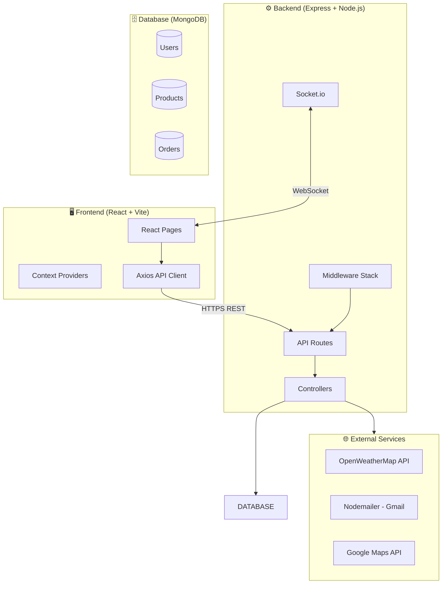

# 🌾 FarmConnect — Farmer Direct Market Platform

<div align="center">


**A full-stack, enterprise-grade MERN application directly connecting Indian farmers with buyers — eliminating middlemen, boosting farmer income, and delivering fresh produce transparently.**

[🌐 Live Demo](https://farmconnect.vercel.app) · [📖 API Docs](https://farmconnect-api.onrender.com/api-docs) · [🩺 Health](https://farmconnect-api.onrender.com/health)

</div>

---

## 📋 Table of Contents

- [Overview](#overview)
- [Architecture](#architecture)
- [Features](#features)
- [Tech Stack](#tech-stack)
- [Folder Structure](#folder-structure)
- [Getting Started](#getting-started)
- [Environment Variables](#environment-variables)
- [Docker](#docker)
- [Deployment](#deployment)
- [API Documentation](#api-documentation)
- [Testing](#testing)
- [Security](#security)
- [Performance](#performance)
- [Monitoring](#monitoring)
- [Future Enhancements](#future-enhancements)
- [License](#license)

---

## 🎯 Overview

FarmConnect is a production-ready MERN marketplace platform featuring:

- **Direct Trade**: Farmers sell directly to buyers — zero middlemen
- **AI-Powered**: Crop disease detection, price prediction, farming chatbot
- **Real-Time**: Socket.io order notifications and live updates
- **Bilingual**: Full English and Tamil (தமிழ்) language support
- **Market Intelligence**: Live mandi prices, weather advisory, demand trends
- **Enterprise Grade**: Docker, CI/CD, Swagger, structured logging, rate limiting

---

## 🏗 Architecture



---

## ✨ Features

### 🛒 Buyer Features
- Browse and search products with filters (category, price, location)
- Add to cart and wishlist
- Place and track orders through 7-stage delivery pipeline
- Rate and review products (1 per buyer per product)
- Real-time order status notifications

### 👨‍🌾 Farmer Features
- Add/edit/delete products with multi-image upload (up to 5 images)
- Manage orders from their product listings
- Sales analytics dashboard with revenue tracking
- AI crop disease detection
- Live weather and market price intelligence

### 👑 Admin Features
- Full user management (view, verify farmers, delete users)
- Platform-wide order management
- Analytics: GMV, top farmers, top products, order trends
- System health monitoring

### 🤖 AI Features (Phase 4)
- **AI Farming Chatbot** — bilingual assistant (English/Tamil)
- **Crop Disease Detection** — upload leaf image for diagnosis
- **AI Crop Recommendation** — based on soil and season
- **Smart Price Recommendation** — dynamic pricing for farmers
- **Product Recommendations** — personalized for buyers

### 🌤 Weather & Market Intelligence
- Live weather + 7-day forecast with farming advisory
- Mandi (market) prices with demand and trend data
- Best sell time recommendations
- Seasonal crop recommendations

### 🔐 Security (Phase 5)
- Helmet HTTP security headers
- Rate limiting (150 req/15min API, 15 req/15min auth)
- MongoDB NoSQL injection protection
- JWT authentication with role-based access control
- Input validation with express-validator
- CORS origin whitelisting

---

## 🛠 Tech Stack

| Layer | Technology |
|---|---|
| Frontend | React 18, Vite 8, Tailwind CSS v4 |
| Backend | Node.js 20, Express.js 4 |
| Database | MongoDB 7 + Mongoose 8 |
| Auth | JWT (jsonwebtoken) + bcrypt |
| Real-time | Socket.io 4 |
| Logging | Winston + Morgan |
| API Docs | Swagger UI (OpenAPI 3.0) |
| Email | Nodemailer (Gmail SMTP) |
| File Upload | Multer (5MB/file, jpg/png/webp) |
| Testing | Jest + Supertest |
| Container | Docker + Docker Compose |
| CI/CD | GitHub Actions |
| Frontend Deploy | Vercel |
| Backend Deploy | Render |
| DB Cloud | MongoDB Atlas |

---

## 📁 Folder Structure

```
Farmer-Direct-Market-Platform-main/
├── .github/
│   └── workflows/
│       └── ci.yml              # GitHub Actions CI/CD
├── backend/
│   ├── controllers/            # Business logic (auth, products, orders, AI, ...)
│   ├── middleware/             # auth.js (JWT + RBAC), validate.js
│   ├── models/                 # Mongoose schemas (User, Product, Order)
│   ├── routes/                 # Express route definitions
│   │   └── healthRoutes.js     # GET /health endpoint
│   ├── services/               # emailService.js (Nodemailer)
│   ├── tests/                  # Jest test suites
│   │   ├── auth.test.js
│   │   ├── product.test.js
│   │   └── health.test.js
│   ├── utils/
│   │   └── logger.js           # Winston logger
│   ├── uploads/                # Product images (gitignored, Docker volume)
│   ├── logs/                   # log files (gitignored, Docker volume)
│   ├── .env                    # Local secrets (gitignored)
│   ├── .env.production.example # Production secrets template
│   ├── Dockerfile              # Backend container
│   ├── package.json
│   ├── server.js               # Entry point
│   └── swagger.js              # Swagger/OpenAPI config
├── frontend/
│   ├── src/
│   │   ├── components/         # Navbar, AIChatbot, WeatherWidget, ProductCard, ...
│   │   ├── context/            # CartContext, LanguageContext, ThemeContext, ToastContext
│   │   ├── pages/              # All pages (Home, ProductBrowse, Dashboards, ...)
│   │   ├── api.js              # Centralized Axios API helpers
│   │   ├── App.jsx             # Root component (lazy loading + routing)
│   │   └── main.jsx            # App entry point (all providers)
│   ├── nginx.conf              # SPA fallback + gzip config
│   ├── Dockerfile              # Frontend container (nginx)
│   ├── .env.production         # Production VITE_API_URL
│   └── vite.config.js          # Vite build + code splitting config
├── docker-compose.yml          # Full-stack Docker orchestration
├── .dockerignore
├── vercel.json                 # Vercel SPA deployment config
├── render.yaml                 # Render backend deployment manifest
└── README.md
```

---

## 🚀 Getting Started

### Prerequisites
- **Node.js** >= 20
- **MongoDB** running locally (`net start MongoDB` on Windows)
- **Git**

### 1. Clone the repository

```bash
git clone https://github.com/YOUR_USERNAME/Farmer-Direct-Market-Platform.git
cd Farmer-Direct-Market-Platform-main
```

### 2. Install dependencies

```bash
# Backend
cd backend && npm install

# Frontend
cd ../frontend && npm install
```

### 3. Configure environment variables

```bash
# Copy the example and fill in values
cp backend/.env.production.example backend/.env
```

Minimum required in `backend/.env`:
```env
MONGO_URI=mongodb://127.0.0.1:27017/farmconnect_v2
JWT_SECRET=any_strong_secret_key_here
```

### 4. Start development servers

```bash
# Terminal 1 — Backend (http://localhost:5000)
cd backend && npm run dev

# Terminal 2 — Frontend (http://localhost:5173)
cd frontend && npm run dev
```

### 5. Seed sample data (optional)

```bash
cd backend && npm run seed
```

---

## 🔑 Environment Variables

### Backend (`backend/.env`)

| Variable | Required | Description |
|---|---|---|
| `PORT` | No | Server port (default: 5000) |
| `MONGO_URI` | **Yes** | MongoDB connection string |
| `JWT_SECRET` | **Yes** | JWT signing secret (min 32 chars) |
| `NODE_ENV` | No | `development` or `production` |
| `ALLOWED_ORIGINS` | No | Comma-separated CORS origins |
| `EMAIL_SERVICE` | No | Email provider (e.g., `gmail`) |
| `EMAIL_USER` | No | Sender email address |
| `EMAIL_PASS` | No | Gmail App Password |
| `WEATHER_API_KEY` | No | OpenWeatherMap API key |
| `GOOGLE_MAPS_API_KEY` | No | Google Maps API key |

### Frontend (`frontend/.env.production`)

| Variable | Required | Description |
|---|---|---|
| `VITE_API_URL` | No | Backend API URL (default: `/api`) |

---

## 🐳 Docker

Run the entire stack with one command:

```bash
# Build and start all services (MongoDB + Backend + Frontend)
docker-compose up --build

# Access points:
# Frontend:   http://localhost:3000
# Backend:    http://localhost:5000
# API Docs:   http://localhost:5000/api-docs
# Health:     http://localhost:5000/health
```

Individual service control:

```bash
# Stop all services
docker-compose down

# Stop and remove volumes (wipes database)
docker-compose down -v

# View logs
docker-compose logs -f backend
docker-compose logs -f frontend
```

> **Note:** The `mongo_data`, `uploads_data`, and `logs_data` Docker volumes persist data across container restarts.

---

## 🚢 Deployment

### Frontend → Vercel

1. Connect your GitHub repository to [vercel.com](https://vercel.com)
2. Set **Root Directory** to `frontend`
3. Set **Build Command** to `npm run build`
4. Set **Output Directory** to `dist`
5. The `vercel.json` handles SPA route rewrites automatically

### Backend → Render

1. Connect repo to [render.com](https://render.com)
2. The `render.yaml` manifest auto-configures the service
3. Set sensitive environment variables in the Render dashboard
4. Set `MONGO_URI` to your **MongoDB Atlas** connection string

### Database → MongoDB Atlas

1. Create a free cluster at [cloud.mongodb.com](https://cloud.mongodb.com)
2. Whitelist `0.0.0.0/0` (or Render's IP range)
3. Create a database user
4. Copy the connection string to `MONGO_URI`

---

## 📖 API Documentation

Once the backend is running, visit:

```
http://localhost:5000/api-docs
```

Swagger UI provides interactive documentation for all endpoints including authentication examples.

### Key Endpoints Summary

| Category | Endpoint | Auth |
|---|---|---|
| Auth | `POST /api/auth/register` | Public |
| Auth | `POST /api/auth/login` | Public |
| Auth | `GET /api/auth/profile` | JWT |
| Products | `GET /api/products` | Public |
| Products | `POST /api/products` | Farmer |
| Orders | `POST /api/orders` | Buyer |
| Orders | `GET /api/orders/my-orders` | Buyer |
| AI | `POST /api/ai/chat` | Public |
| AI | `POST /api/ai/diagnose-crop` | Public |
| Weather | `GET /api/weather?city=Erode` | Public |
| Market | `GET /api/market/trends` | Public |
| Admin | `GET /api/admin/stats` | Admin |
| Monitoring | `GET /health` | Public |

---

## 🧪 Testing

```bash
# Run all backend tests
cd backend && npm test

# Run tests with verbose output
cd backend && npm test -- --verbose
```

Test suites cover:
- ✅ `health.test.js` — System health endpoint
- ✅ `auth.test.js` — Registration, login, invalid credentials
- ✅ `product.test.js` — Product listing, unauthorized access

---

## 🔐 Security Checklist

- [x] `helmet` — Sets 11 HTTP security headers
- [x] Rate limiting — 150/15min (API), 15/15min (auth)
- [x] `express-mongo-sanitize` — Blocks NoSQL injection
- [x] `express-validator` — Input validation
- [x] `bcrypt` — Password hashing (10 rounds)
- [x] JWT — Stateless auth with 7-day expiry
- [x] RBAC — Role middleware on every protected route
- [x] CORS — Origin whitelisting in production
- [x] File upload validation — jpg/png/webp, 5MB max
- [x] Structured error responses (no stack traces in production)
- [x] Auth failures logged to `logs/error.log`

---

## ⚡ Performance

### Backend
- `compression` middleware — Gzip all responses
- MongoDB compound and text indexes on Products and Orders
- Connection pooling via Mongoose

### Frontend
- **Code Splitting** — Vendor chunks (react, lucide, axios) + page chunks
- **Lazy Loading** — Heavy pages load on demand (React.lazy + Suspense)
- **nginx** — Serves static assets with 1-year cache headers
- **Vite** — Optimized production build with tree shaking

---

## 🩺 Monitoring

```bash
GET /health
```

Returns:
```json
{
  "status": "OK",
  "timestamp": "2026-08-04T17:00:00.000Z",
  "uptime": 3600,
  "database": "connected",
  "memory": {
    "rssMB": 64.5,
    "heapTotalMB": 32.1,
    "heapUsedMB": 28.3
  },
  "environment": "production",
  "version": "5.0.0"
}
```

### Logs

All logs written to `backend/logs/`:
- `combined.log` — All requests and events
- `error.log` — Errors and warnings only

---

## 🛣 Future Enhancements

- [ ] Razorpay / Stripe payment gateway integration
- [ ] Redis caching for hot product listings
- [ ] PWA (Progressive Web App) offline support
- [ ] Native iOS/Android app (React Native)
- [ ] Advanced AI with real crop disease ML model (TensorFlow.js)
- [ ] Admin audit trail and activity logs
- [ ] Supplier onboarding verification workflow
- [ ] Multi-tenant support for state-level cooperatives
- [ ] GraphQL API layer
- [ ] Elasticsearch for advanced product search

---

## 👥 Contributors

Built with ❤️ for Indian Farmers.

---

## 📄 License

This project is licensed under the **MIT License** — see [LICENSE](LICENSE) for details.

---

*FarmConnect v5.0.0 — Production Ready | Phases 1–5 Complete*
